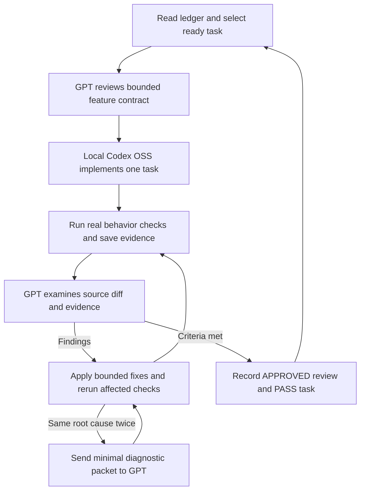

# Local model development with GPT backed Codex

The owner has since authorized the [automatic sequential controller](AUTOMATIC_DEVELOPMENT.md). Use `.\scripts\start-development.ps1 -Execute -Background` to execute all T01–T42 tasks with prerequisite checks, local admission, bounded repair, recorded GPT implementation failover and separate GPT review. Individual commands below remain available for assessment and supervised sessions; the earlier inventory-only launch boundary is historical. Current progress comes from the ledgers and controller state.

Selected provider: **LM Studio**, chosen by the owner on 10 October 2026. Use an installed model, an exact served identifier and a bounded capability trial before application implementation. The assessed endpoint returned `qwen3.8-flash-next`, `qwen3.8-27b` and an embedding model. Only the first was loaded at assessment. An embedding model cannot be the coding implementer.

## Responsibilities and review flow

The local model implements one task and collects real checks. GPT-backed Codex makes the task precise, reviews source and evidence, diagnoses difficult failures and records acceptance. Product AI inside the booking app is separately implemented in T16–T19 and T31–T35; development shell access does not become a product capability.



This is an explicit task/review workflow. The wrapper executes one requested role and stops; it does not launch an unbounded daemon or silently advance to the next feature. The supervisor must actually inspect source and evidence.

## Verified Codex interface

Official Codex documentation supports a local provider selected with `--oss`, with `lmstudio` or `ollama`, and a model override. Noninteractive execution accepts stdin, structured final output and a final-message file. The installed 0.162.1 CLI help confirms these switches. Provider availability does not establish a particular model's tool quality. [Official developer commands](https://learn.chatgpt.com/docs/developer-commands?surface=cli), [noninteractive execution](https://learn.chatgpt.com/docs/non-interactive-mode).

The support wrappers select Local versus Review explicitly, require exact model IDs, check dependencies, preserve private run folders and inspect result shape. They do not change your global Codex configuration or install/download models. The run report is a review candidate, not a successful feature merely because its JSON is valid.

## Readiness checks

```powershell
.\scripts\agent-doctor.ps1
.\scripts\verify-workflow.ps1
Invoke-RestMethod -Uri 'http://127.0.0.1:1234/v1/models'
codex --version
codex exec --help
```

Use the model ID returned by the serving process. Keep the server on loopback. In WSL, test reachability from that environment and use its path conventions. Do not change shared model loads blindly; check memory and existing work first. Actual RAM/GPU observations are in the repository assessment. Context length, quantization, offload and parallelism must be measured on this workstation.

The first isolated trial used loaded `qwen3.8-flash-next`. LM Studio reported a 75.44 GB model, 262144-token context and four parallel slots. The process remained in prompt processing without a tool response and was stopped after a bounded attempt. Codex's header also reported read-only despite the requested workspace-write mode. No fixture was repaired and no local coding capability PASS is claimed. See the startup report for observed evidence and next trial steps.

Use LM Studio to select a smaller installed coding model such as the listed `qwen3.8-27b`, with a measured context and conservative concurrency. This is a trial candidate, not a proven quality recommendation. Validate its exact ID after loading. Complete read/edit/test/diff behavior and ensure the sandbox actually permits the intended workspace writes before running T01. A stalled large model is not an application defect.

Windows sandbox selection and effective permissions are separate from model connectivity. The official Windows guide describes supported native implementations and diagnostics. The one-command MXC probe returned `MXC_OK` with exit 0 on this workstation; use the wrapper's per-invocation `-WindowsSandbox mxc` for the next trial and verify effective write permissions. If the header grants only read access, diagnose that configuration instead of bypassing the sandbox. [Official Windows sandbox guide](https://learn.chatgpt.com/docs/windows/windows-sandbox).

## Capability trial and admission criteria

Create an isolated disposable directory outside the app source and initialize its own temporary Git repository. Supply a deliberately wrong small function and independent tests with clear expected outputs, invalid inputs and a nonzero failing result. Ask Codex to read the files, change only the function, run the unchanged tests and inspect the diff. Preserve the initial failure and final output. Use a short explicit deadline; stop only the process you launched if it stalls.

Accept the development model only after it demonstrates all of:

- Actual file-read, bounded edit and shell/test tools work, not merely a prose answer.
- Independent behavioral assertions pass and the test file is unchanged.
- Diff contains only the requested repair; failure results are reported accurately.
- A second session can read the small packet and resume without inventing progress.
- A structured-output trial validates against `contracts/local-result.schema.json` without false PASS.

The existing `.local-ai-trial` contains only a synthetic seat arithmetic fixture; it is ignored and never becomes the booking engine. If tools or structured output remain incompatible, ask the local model for a reviewed patch, apply it through GPT-backed Codex, and run tests independently. Keep the same feature contracts and evidence requirements. Patch mode is an explicit fallback with recorded limitations.

## Start T01

```powershell
.\scripts\prepare-task.ps1 -TaskId T01 -DryRun
.\scripts\prepare-task.ps1 -TaskId T01
```

The second command saves a bounded preparation packet in a new private run directory. It does not implement the application. Read `docs/features/T01.md`, install/resolve the Java toolchain, then use an admitted model:

```powershell
$codingModel = 'YOUR_EXACT_TESTED_LM_STUDIO_MODEL_ID'
.\scripts\run-codex-task.ps1 -TaskId T01 -Role Local -Provider lmstudio -Model $codingModel -WindowsSandbox mxc -MaxRunSeconds 300 -DryRun
.\scripts\run-codex-task.ps1 -TaskId T01 -Role Local -Provider lmstudio -Model $codingModel -WindowsSandbox mxc -MaxRunSeconds 300 -Execute
```

Before execution, the GPT supervisor sets the task to `IN_PROGRESS`, increments its attempt count and records the bounded session in both ledger views. The local model then treats those ledgers as read-only. The wrapper refuses unsatisfied dependencies and unknown endpoint model IDs. Its process deadline and actual command line are recorded with each execution. Read-only review and workspace implementation use different requested permission modes; verify the effective startup header. Never turn a timed-out process or missing result into a successful task.

Only one implementation writer should run at a time. A feature packet can be split into bounded sessions, but the parent task stays incomplete until all criteria are met. Resolve versions in T01 and frontend framework in T27, as assigned. Do not fabricate application `make` commands that the plan expects later.

## GPT review and acceptance

After a local attempt, use the actual run folder:

```powershell
.\scripts\build-review-packet.ps1 -TaskId T01 -RunDirectory 'docs/execution/runs/ACTUAL_T01_LOCAL_RUN_FOLDER'
```

Prefer this existing GPT-backed Codex chat for supervision: give it the generated review packet path and `docs/prompts/SUPERVISOR.md`, and ask it to inspect the real diff/source plus command evidence. This workspace is available in the chat; an unrelated external ChatGPT chat cannot automatically see it and needs the relevant redacted material.

An optional authenticated CLI reviewer uses an available GPT model ID from your own session:

```powershell
$reviewModel = 'gpt-YOUR_AVAILABLE_MODEL_ID'
.\scripts\run-codex-task.ps1 -TaskId T01 -Role Review -Model $reviewModel -ReviewPacketPath 'docs/execution/runs/ACTUAL_REVIEW_PACKET_FOLDER/packet.json' -DryRun
```

Inspect the preview and use `-Execute` when invoking that review. GPT credentials/account access are provided through your normal Codex sign-in; no key belongs in a repository or prompt. Review execution may send the packet/source context to the selected hosted provider. The packet builder avoids secret paths and redacts common values, but inspect it before sharing. Credentials and complete raw logs remain excluded.

The schemas use local status `NEEDS_REVIEW`, `FAILED` or `BLOCKED`, and review decisions `APPROVE`, `REQUEST_CHANGES` or `BLOCKED`. A supervisor translates an adequate `APPROVE` into ledger review `APPROVED`. It records task PASS only after all mandatory tests/evidence are sufficient and tied to the reviewed source. The wrappers never promote the ledger themselves. Update both JSON and Markdown ledger views, attempt count, revision/evidence and next-step. A dependency requires PASS plus APPROVED and actual revision/evidence.

Two repairs at the same root cause produce the diagnostic packet from `docs/execution/templates/diagnostic-packet.md` and use the focused repair prompt. A blocked dependency prevents the next task; independent ready work can still continue. Keep logs and fixture/provider/live status separate.

For a rejected, failed or timed-out attempt, use `build-review-packet.ps1` with `-Diagnostic` and its actual run directory. Diagnostic packets preserve failures and cannot receive an approval result. They guide the next repair rather than granting task completion.

## Release verifier scope

The future application entrypoint remains `make verify-release`, or the reviewed cross-platform equivalent, with explicit `SCOPE=backend` at T26 and `SCOPE=application` at T41. Backend scope covers retained V01–V26 and backend criteria. Application scope also covers A01–A20 and all applicable frontend/builder criteria. T42 H01 completes handbook/pilot/owner acceptance afterward. These entrypoints do not exist yet; implement them in their assigned tasks. A missing mandatory gate cannot return success.

## Optional Ollama and gpt oss

Codex OSS means a local open-model provider; it does not require an OpenAI `gpt-oss` checkpoint. The owner selected LM Studio with an installed model. Ollama is another supported route after its server is running and exact model inventory has been validated; no Ollama model was used in the recorded trial.

OpenAI's local guide documents `gpt-oss:20b` and `gpt-oss:120b` through Ollama. Neither is installed here. Choosing one later entails an explicit download and a fresh measured capability trial; the 16 GB GPU observation does not guarantee a useful working context or latency. [Official gpt-oss local guide](https://developers.openai.com/cookbook/articles/gpt-oss/run-locally-ollama).

## Product model integration later

T16 will implement a separate model gateway with base URL, served model ID, credentials reference, deadlines, cancellation, token/tool budgets and admission control. T17 adds independently authorized tools, T31–T33 add blueprint data and owner publication, and T35 verifies live local inference inside the app. Current development setup does not implement those runtime components, and this toy trial is not gate V16.
