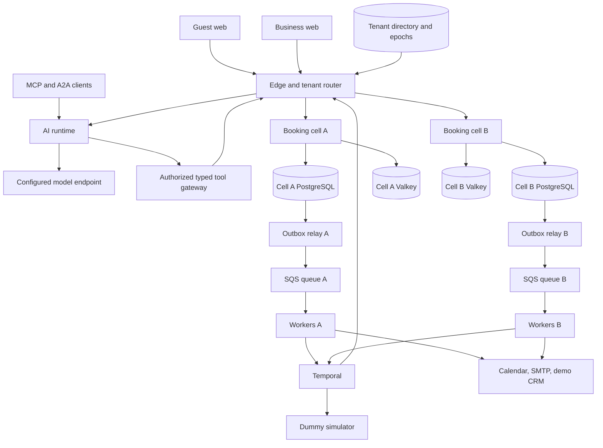

# Application system design baseline

Status: adopted design baseline for implementation; no deployment is claimed. Source priority: master plan v2, retained backend v1 invariants, design DOCX v2, then these support documents. Exact versions and framework choices remain subject to recorded compatibility checks.

## Topology and ownership



| Deployable | Owns | Must not own |
| --- | --- | --- |
| `edge-router` | Slug resolution, membership/route lookup, coarse quotas, transport auth, correlation and routing | Allocation decisions, model-provided tenant authority |
| `booking-api` per cell | Catalogue, scheduling, guest grants, proposals, approvals, reservations, blueprint publication, authoritative command transactions | Real payment gateways, model inference, remote writes inside inventory transactions |
| `agent-runtime` | Provider adapters, bounded runs/checkpoints, structured tool calls, SSE, MCP/A2A adapters | Database mutation bypass, approval fabrication, arbitrary SQL/code/shell tools |
| `background-worker` per cell | Inbox/outbox relay, reminders, Temporal Activities, calendars, retention, projections, signed webhook delivery | Independent inventory truth, unchecked stale-cell mutations |
| `dummy-payment-simulator` | Persistent simulated intents, controlled scenarios and signed callbacks | Card/bank details, financial credentials, real money/provider calls |
| `guest-web` | Public discovery, anonymous session, booking/manage flow, optional assistant | Business tokens, private catalogue fields, frontend-only authorization |
| `business-web` | OIDC operations, calendar, builder preview/diff, integrations, metrics, audit | Owner approval inferred from model text, unreviewed executable page generation |

The authorized tool gateway can be a module/adapter in the AI runtime rather than an extra network service. It authenticates the original actor independently of the model and invokes the same public/business/internal domain operations as deterministic clients. Application authorization remains necessary even with RLS.

## Module and repository boundaries

Create application code in the inspected project root, preserving supplied plans. Suggested paths:

```text
pom.xml, mvnw, mvnw.cmd
apps/{edge-router,booking-api,agent-runtime,background-worker,dummy-payment-simulator}/
apps/{guest-web,business-web}/
modules/{domain,application,persistence,security,api-contracts,integrations,workflow,observability,blueprints}/
packages/ui/                       shared trusted React components
contracts/                         generated OpenAPI and approved schema versions
tests/{integration,e2e,agent-evals,performance}/
deploy/{compose,helm/booking-platform,terraform/aws,local-identity}/
scripts/
docs/{architecture,execution,verification,runbooks,api}/
```

Domain records and commands have no HTTP, persistence or provider dependencies. Application services orchestrate transactions through explicit ports. JDBC repositories implement persistence. HTTP controllers, Temporal Activities and model tools adapt typed contracts into the same services. Catalogue, availability, booking, capacity and blueprints share the booking cell database; avoid distributing a reservation across services.

## Authoritative boundaries

The directory owns `tenant → cell, routeEpoch`. Each cell has its own writer-fence row for every tenant. Every write checks the expected epoch and writable state inside its transaction. A stale edge cache cannot authorize a stale cell writer. Public slugs resolve server-side; a tenant header or model argument never establishes authority.

All tenant data uses tenant-aware keys, RLS and restricted runtime roles. Workers iterate explicit tenant jobs and establish fresh scoped transactions. Directory/admin/migration credentials are separate from booking credentials. A two-cell drill must state its remaining shared dependencies: shared directory, Temporal, issuer or physical host may still be common failure points. Keep cell booking databases, caches, queues and routable API instances independent for the promised local cell test.

Cache results only suggest inventory. `booking-api` uses writer-side locks and constraints for final acceptance. Events are at least once; state plus outbox commit atomically. Reminder scheduling has durable job/start records. No notification, model, calendar or simulator network request occurs inside a resource allocation transaction.

## Scheduling guard baseline

Start with one `tenant_schedule_guard` row per tenant, deliberately favoring simple correct locking. Booking/inventory/configuration/external-busy mutations acquire it, increment its monotonic revision on commit, then lock subordinate resource/session/booking rows in the agreed order. Blueprint impact/publication uses the same guard. Later splitting to resource/location guards requires a new ADR and concurrency proof, including phantoms and impact races.

Availability cache keys include tenant, service/location/filter set, zone/date range, relevant config version and guard revision; use bounded TTL, invalidation and request coalescing. Quota-cache outage has a defined bounded fallback, while PostgreSQL still protects inventory. Performance goals are measured after correctness, not a reason to weaken locks or constraints.

## Optional service behavior

| Dependency problem | Required application behavior |
| --- | --- |
| Model unavailable/quota exhausted | Agent run fails visibly; manual guest booking remains usable |
| Simulator stopped | `paymentRequirement=NONE` path works; simulated-deposit attempts show truthful pending/failure |
| Outbox relay/queue unavailable | Accepted transaction remains durable; bounded backlog visible; eventual relay recovery |
| Temporal worker stopped | Hold confirmation still checks deadline; durable jobs restart safely |
| Calendar stale/revoked | Connection health visible; required-calendar policy bounds affected new inventory; existing bookings remain persisted |
| One cell stopped | Other cell remains usable within declared shared-dependency envelope |
| SMTP ambiguous timeout | Delivery status can be `UNKNOWN`; do not assert exactly-once message delivery |

Readiness reflects dependencies required for that deployable to serve its actual function. Liveness excludes optional external services. Guest booking must not require OIDC provider, AI or simulator availability; existing authenticated staff tokens may have separate issuer/key-cache behavior to test.

## Security and frontend delivery

Use same-origin guest and business API routes where feasible. Browser sessions use scoped `HttpOnly` cookies with secure production settings and explicit CSRF protection; choose `SameSite` and OIDC callback behavior together. CORS uses an allowlist with credentials only where required. Production TLS/ingress configuration is distinct from loopback local development.

Management links include the public business slug and a URL fragment token. Resolve the slug server-side and exchange the secret via body/header within the resolved tenant; no global grant scan or caller-controlled tenant authority is required. Clear the fragment with history replacement and apply `Referrer-Policy: no-referrer`; no analytics sees credentials or contact form values. CLI examples use bearer grants. Business identities require verified OIDC and current membership; UI controls are conveniences, server authorization is decisive.

Guest preview and published pages use the same trusted component renderer, versioned blueprint payload and validation. Branding is validated data. No model-authored JavaScript/HTML, arbitrary CSS injection or executable automation is admitted. Never put staff/customer data or tokens in public bundles/SSR output/cache. T27 records the framework and public SEO/rendering decision; this document does not prematurely pin a React framework.

## Local deployment and operational profiles

- `core`: booking/edge, PostgreSQL, Valkey, Keycloak, queue, workflow storage/Temporal, workers and local inbox. Uses actual services and opt-in synthetic seeds.
- `ai`: adds runtime configured with the actual served model ID and operator-approved endpoint. Real model diagnostics are separate from deterministic test fixtures.
- `demo`: explicitly enables the simulator/operator scenarios, with visible simulation labels.
- `observability`: metrics, tracing and bounded logs; synthetic identifiers only in demonstration evidence.
- `two-cell`: independent booking stacks and route/fencing/migration drill.

Final Compose and kind acceptance includes actual browser/API journeys, inbox delivery, restart/replay and restore, not just health checks. Use a dedicated `booking-dev` cluster/namespace and verified context. Keep data volumes by default on shutdown. Measure available resources and the chosen model before prescribing a “small machine” profile. Cloud templates are required; actual cloud provisioning has separate environment/account authorization.

## Technical reference checks

Compatibility must be verified against the selected versions at T01. [Spring Boot system requirements](https://docs.spring.io/spring-boot/system-requirements.html) and [Spring AI documentation](https://docs.spring.io/spring-ai/reference/) are the primary compatibility starting points. Temporal workflows must preserve deterministic replay; provider/database/inference work goes into Activities. See [Temporal workflow definition](https://docs.temporal.io/workflow-definition). Version protocol adapters against official [MCP](https://modelcontextprotocol.io/) and [A2A](https://a2a-protocol.org/latest/specification/) specifications during T19; no protocol version is claimed tested here.
